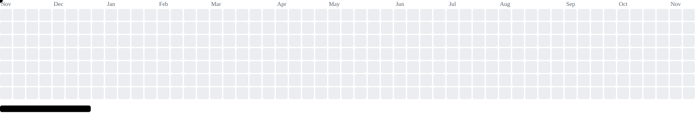

<!-- Profile README — Renzo Cosentino / CynarJulep · 2026 -->

**Licenciado en Sociología (UNL) · encuestas, datos administrativos y sistemas en producción · París**

 

---

## Qué construyo

Diseño bases de datos y dispositivos de encuesta (**2 000+ habitantes** en terreno), automatizo pipelines de análisis y reporte (**R / Python / PostgreSQL / RMarkdown**) y desarrollo herramientas internas para administraciones públicas y eventos masivos.

| Sistema / Proyecto | Impacto |
|---|---|
| [**Certificados IMUSA**](https://certificadosimusa.com.ar/) | Base PostgreSQL diseñada desde cero y portal oficial de emisión/validación veterinaria |
| **Atención ciudadana & PAI · Santa Fe** | Base geolocalizada de 3 años de reclamos (500 000 hab.), tablero de 56 000+ llamadas y CRM |
| **Observatorio de estadísticas** | Encuestas en 10 barrios, Anuario *Santa Fe Cómo Vamos* y −70 % de tiempo de producción en R |
| **Juegos Suramericanos Santa Fe 2026** | Planificación de recepción para 4 000+ atletas de 15 países y app de tickets para 20–30 voluntarios |
| [**compresor**](https://github.com/CynarJulep/compresor) | Utilidad offline en Python + Streamlit para comprimir/fusionar PDFs e imágenes sin exponer datos |

> Los sistemas con datos ciudadanos o personales viven en repositorios privados; aquí abajo están los proyectos públicos y demos.

---

## Stack

  
  

  
  
  
  
  
  
  
  
  
  
  

---

## Repos públicos

| Repo | Stack | Descripción | Demo |
|---|---|---|---|
| [**compresor**](https://github.com/CynarJulep/compresor) | Python · Streamlit | Compresor y unificador offline de PDFs e imágenes administrativas | — |
| [**organizador-pai**](https://github.com/CynarJulep/organizador-pai) | Node.js · PostgreSQL | Circuitos PAI, PDFs y flujos operativos entre áreas municipales | — |
| [**whatsapp-pdf-bot**](https://github.com/CynarJulep/whatsapp-pdf-bot) | Node.js · Docker · Supabase | Bot de orientación y envío de PDFs vía WhatsApp | [**ac-pai-wp.netlify.app ↗**](https://ac-pai-wp.netlify.app/) |
| [**feriado-widget**](https://github.com/CynarJulep/feriado-widget) | HTML · CSS · JS | Widget ligero para consultar próximos feriados en Argentina | [**GitHub Pages ↗**](https://cynarjulep.github.io/feriado-widget/) |
| [**Trabajo-Final-Eant**](https://github.com/CynarJulep/Trabajo-Final-Eant) | R · Shiny · Leaflet | Análisis espacial del delito en CABA (EANT Social Data Analytics) | — |

---

## Stats

  
  
  

 

  
  

 

  

### Arcade

<picture>
  <source media="(prefers-color-scheme: dark)" srcset="https://raw.githubusercontent.com/CynarJulep/CynarJulep/output/github-contribution-grid-snake-dark.svg" />
  <source media="(prefers-color-scheme: light)" srcset="https://raw.githubusercontent.com/CynarJulep/CynarJulep/output/github-contribution-grid-snake.svg" />
  
</picture>

 

<picture>
  <source media="(prefers-color-scheme: dark)" srcset="https://raw.githubusercontent.com/CynarJulep/CynarJulep/output/pacman-contribution-graph-dark.svg" />
  <source media="(prefers-color-scheme: light)" srcset="https://raw.githubusercontent.com/CynarJulep/CynarJulep/output/pacman-contribution-graph.svg" />
  
</picture>

 

<picture>
  <source media="(prefers-color-scheme: dark)" srcset="https://raw.githubusercontent.com/CynarJulep/CynarJulep/output/breakout-contribution-graph-dark.svg" />
  <source media="(prefers-color-scheme: light)" srcset="https://raw.githubusercontent.com/CynarJulep/CynarJulep/output/breakout-contribution-graph.svg" />
  
</picture>

---

